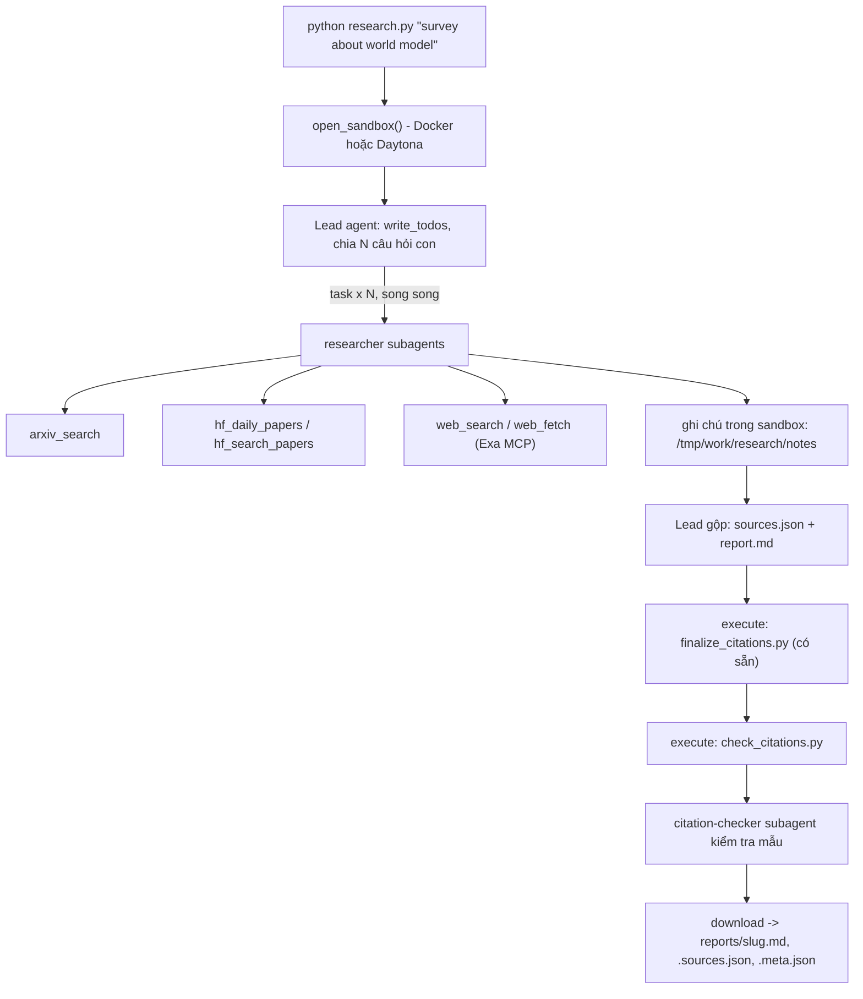

# Deep Research Agent (Deep Agents + Sandbox)

## Bản triển khai và chạy trên Windows

Bốn module sinh viên đã được triển khai. Hướng dẫn vận hành gọn từ harness nằm
trong `PROJECT_CONTEXT.md`, `PLAN.md`, `docs/AGENT_CONTRACT.md`; kết quả kiểm tra
thực tế nằm trong `docs/VERIFICATION.md`. Các fixture trong `tests/` là giả lập,
không phải báo cáo nộp bài.

Đã chạy đủ năm báo cáo thật bằng GPT-6 Luna + Docker và self_check.py pass.
Mở [kết quả và liên kết báo cáo](docs/FINAL_RUN.md) và [review nguồn](docs/REPORT_REVIEW.md)
để xem phạm vi kiểm tra, các lỗi đã sửa và metadata của từng lượt chạy.

```powershell
py -3.11 -m venv .venv
.venv/Scripts/python.exe -m pip install -r requirements.txt
# Điền .env theo .env.example; không đưa khóa lên Git hoặc vào chat.
# Với Docker: đặt SANDBOX=docker và khởi động Docker Desktop (Linux containers).
.venv/Scripts/python.exe -m unittest discover -s tests -v
.venv/Scripts/python.exe scripts/smoke_sources.py
.venv/Scripts/python.exe research.py "survey about world model"
.venv/Scripts/python.exe run_topics.py
.venv/Scripts/python.exe self_check.py
.venv/Scripts/python.exe scripts/verify_submission.py
```

`run_topics.py` chạy lần lượt 5 chủ đề và dừng ở lần thất bại đầu tiên. Mỗi lần
chạy thật dùng token của LLM; không chạy lại khi cấu hình chưa sẵn sàng.
`scripts/smoke_sources.py` không gọi LLM, chỉ thử mỗi endpoint một lần để chẩn
đoán nhanh; `python tools.py` dùng đầy đủ retry của ứng dụng. Với cấu hình hiện
tại chỉ cần khóa OpenAI và Docker: Exa dùng endpoint không khóa. Khi Exa trả lỗi
tạm thời, `web_fetch` thử đọc HTML/text trực tiếp từ URL công khai sau ba lần thử.
Riêng các trang học thuật arXiv, HF, ACL, CVF và NeurIPS được đọc HTML gốc trước
để giữ metadata và tránh số chú thích bị ghép vào số liệu.
Khi tìm kiếm Exa thất bại tạm thời sau ba lần thử, cấu hình `openai:<model>`
dùng web search của Responses API với cùng model và khóa OpenAI. Chỉ nhận kết
quả tìm kiếm hoàn tất, có URL trích dẫn; các lời gọi này cũng tính phí OpenAI.
Với endpoint tùy biến hoặc không có khóa OpenAI, công cụ trả lỗi để agent đổi nguồn.

Trong `reports/`, `.md` là báo cáo, `.sources.json` là nguồn đã trích dẫn,
`.meta.json` là thống kê từ tin nhắn lead. Token không bao gồm subagent và không
đại diện tổng chi phí (cũng chưa gồm tìm kiếm OpenAI dự phòng). Report và sources
được giữ nguyên bytes tải từ sandbox.
Chỉ có kết quả chạy thật mới được ghi ở đây; chưa đủ năm bộ tệp thì chưa sẵn
sàng nộp bài, dù kiểm thử mã đã pass.

Để dùng GPT-6 Luna với OpenAI, đặt `LAB_MODEL=openai:gpt-6-luna`,
`OPENAI_API_KEY=<khóa của bạn>` và `SANDBOX=docker` trong `.env`.
Runner tự chọn Responses API cho Luna để dùng tool calling cùng reasoning.
SDK dùng timeout 120 giây mỗi lần gọi và tối đa hai lần retry; console in tên
công cụ đang chạy để theo dõi tiến độ, không in prompt hoặc khóa.
Không cần đặt `LAB_TEMPERATURE`. Quyền truy cập model phụ thuộc tài khoản API.
Xem [tài liệu model](https://developers.openai.com/api/docs/models/gpt-6-luna).

Lab dựng một **hệ thống deep research đa tác tử**: người dùng chỉ cần nhập một chủ đề (ví dụ `survey about world model`), hệ thống tự lập kế hoạch, giao việc cho nhiều subagent, tìm tài liệu trên arXiv, Hugging Face và web, rồi viết một **báo cáo có trích dẫn**.

Hình thức: **bài thực hành cá nhân**. Ngôn ngữ lập trình: Python 3.11 trở lên.

## 1. Mục tiêu học tập

Sau lab, bạn có thể:

1. Dựng agent bằng thư viện Deep Agents (LangChain): công cụ (tool), system prompt, subagent, backend.
2. Dùng **sandbox** (Daytona) làm không gian làm việc và nơi chạy mã cho agent; hiểu vì sao khóa API và công cụ mạng phải nằm ở phía host chứ không nằm trong sandbox.
3. Viết công cụ gọi API ngoài **chịu được giới hạn tốc độ** (retry, backoff, jitter, `Retry-After`).
4. Thiết kế quy trình đa tác tử: lead chia nhỏ câu hỏi, giao cho N researcher chạy song song, tổng hợp và kiểm tra trích dẫn.
5. Tạo báo cáo có thể kiểm chứng: mọi khẳng định có `[n]` trỏ tới một nguồn có thật.

## 2. Hệ thống làm gì



Nguồn dữ liệu:

| Nguồn | Dùng để |
|---|---|
| arXiv API `https://export.arxiv.org/api/query` | Tìm bài theo từ khóa, sắp theo ngày |
| Hugging Face Daily Papers `/api/daily_papers` | Bài đang "trending": upvotes, githubRepo, summary |
| Hugging Face papers search `/api/papers/search?q=` | Tìm bài theo chủ đề |
| Web qua Exa MCP (`web_search_exa`, `web_fetch_exa`) | Blog, survey, trang dự án, nội dung đầy đủ của một URL |

## 3. Cấu trúc thư mục

```
Lab/
├── README.md  GUIDE.md  RUBRIC.md  REPORT_TEMPLATE.md   tài liệu
├── topics.md                 5 chủ đề cần chạy
├── requirements.txt  .env.example  .gitignore
├── model.py                  CÓ SẴN - không sửa: tạo mô hình LLM từ biến môi trường
├── sandbox.py                CÓ SẴN - không sửa: sandbox Daytona (hoặc Docker), upload, download
├── self_check.py             CÓ SẴN - không sửa: tự kiểm tra trước khi nộp (python self_check.py)
├── finalize_citations.py     CÓ SẴN - không sửa: script chạy trong sandbox, tự sinh `## References` và đánh số lại trích dẫn
├── tools.py                  SINH VIÊN CÀI ĐẶT: retry + 5 công cụ nguồn dữ liệu
├── agents.py                 SINH VIÊN CÀI ĐẶT: prompt, subagent, lead agent
├── research.py               SINH VIÊN CÀI ĐẶT: script chính
├── check_citations.py        SINH VIÊN CÀI ĐẶT: kiểm tra trích dẫn, chạy TRONG sandbox
└── reports/                  báo cáo sinh ra (bạn commit vào repo nộp)
```

Các tệp "SINH VIÊN CÀI ĐẶT" đã có triển khai; docstring và số mục giữ liên hệ với `GUIDE.md`.

## 4. Cài đặt

```bash
python3 -m venv .venv && source .venv/bin/activate      # Python 3.11+
pip install -r requirements.txt
cp .env.example .env                                     # rồi điền khóa CỦA BẠN
```

Khóa LLM là bắt buộc khi dùng API trả phí; khóa sandbox và tìm kiếm là tùy chọn
khi chạy Docker và Exa không khóa (điền vào `.env`, **không bao giờ commit** `.env`):

| Khóa | Lấy ở đâu | Ghi chú |
|---|---|---|
| LLM (`LAB_MODEL` + khóa nhà cung cấp) | Nhà cung cấp bạn chọn (OpenAI, Anthropic, Google, OpenRouter, Ollama...) | Mô hình **phải hỗ trợ tool calling**. Chép tên mô hình từ tài liệu của nhà cung cấp. |
| `DAYTONA_API_KEY` | https://app.daytona.io | Kiểm tra gói miễn phí / credit hiện hành. Không có tài khoản hoặc hết credit: đặt `SANDBOX=docker` để chạy sandbox trong container Docker cục bộ (xem `.env.example`). |
| `EXA_API_KEY` (khuyến nghị) | https://dashboard.exa.ai/api-keys | Có thể chạy không khóa, nhưng bản miễn phí của MCP bị giới hạn tốc độ rất nhanh. |

## 5. Làm bài

Làm theo thứ tự (chi tiết trong `GUIDE.md`):

1. `check_citations.py`: khởi động nhẹ, thuần Python.
2. `tools.py`: viết `with_retry` và 5 công cụ. Thử riêng từng công cụ: `python tools.py`.
3. `agents.py`: viết prompt, subagent và lead agent.
4. `research.py`: ghép tất cả; chạy một chủ đề:

```bash
python research.py "survey about world model"
```

Kết quả nằm ở `reports/survey-about-world-model.md` cùng `.sources.json` và `.meta.json`.

## 6. Chủ đề và nộp bài

- Chạy đủ **5 chủ đề** trong [`topics.md`](topics.md), mỗi chủ đề một lần.
- Commit mã nguồn và toàn bộ `reports/`, đẩy lên một **public repo** GitHub và nộp link.
- Kiểm tra trước khi nộp: chạy **`python self_check.py`** (không tốn token): nó kiểm tra đủ 5 báo cáo, `meta.json`, trích dẫn bằng `check_citations.py` của bạn, và không có `.env`/khóa nào trong git.
- Cách chấm: xem [`RUBRIC.md`](RUBRIC.md).

## 7. Thời gian, chi phí và an toàn

- Dùng một mô hình **rẻ nhưng hỗ trợ tool calling**, và **đặt giới hạn** (số lần gọi mô hình/công cụ cho lead và subagent, `recursion_limit`): một prompt hỏng có thể khiến agent lặp rất lâu. Đây là hạng mục 2.5 của `RUBRIC.md`.
- Kết quả có tính ngẫu nhiên: cùng một mã có thể cho báo cáo hợp lệ ở lần này và trích dẫn lỗi ở lần sau. Hãy sửa **prompt và mã**, không sửa tay báo cáo.

- Mỗi lần chạy tốn token LLM và thời gian sandbox. `tokens` trong `meta.json` chỉ đếm tin nhắn của lead, chưa gồm subagent, nên chi phí thật cao hơn. `open_sandbox()` luôn dừng và xóa sandbox khi kết thúc, kể cả khi lỗi. Đừng bỏ qua nó.
- **Không đưa bí mật vào sandbox.** Sandbox không ngăn được prompt injection hay việc đẩy dữ liệu ra mạng; một trang web độc hại có thể khiến agent chạy lệnh bên trong sandbox. Vì vậy mọi công cụ gọi mạng và mọi khóa ở lại phía host.
- Nội dung lấy từ web là **dữ liệu không đáng tin**: agent không được làm theo chỉ dẫn nằm trong đó.
